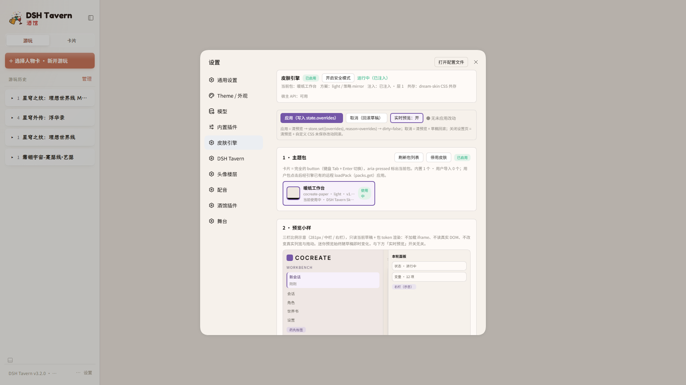
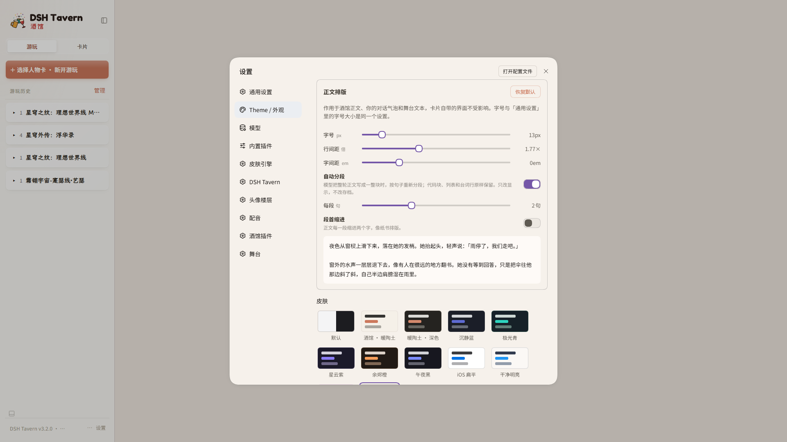
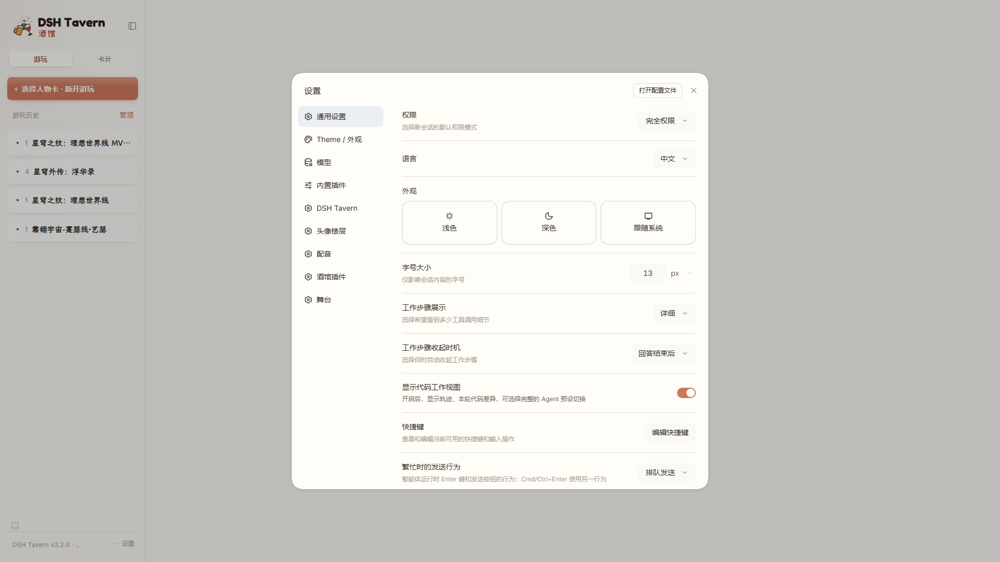

# dsh-tavern-skin-engine

DSHTavern 皮肤引擎：把 **token 变量层 + 分区/组件/字体 + 完整主题包（导入/导出/回收站）** 装进 Tavern 的设置页，并与 dream-skin 安全共存。

**当前状态：Step 1–7 全绿，版本 `0.2.0`（Step 7 发布版）。**
实测环境：Tavern `3.2.0` / DSH `0.2.1-rc.2` / Node `24.12`（Windows）。

> **GitHub 仓库**：<https://github.com/SilverLark257/DSHT-Skin-Engine> · 发布版 **v0.2.0**（Step 7）· 许可证 **MIT** · 测试 **240/240**。

- 设置页新增「皮肤引擎」一节（15 行：包选择、颜色微调、预览、导入/导出、管理、诊断、高级/安全模式）。
- 换肤不重启、不写玩家会话；主题包与设置在插件目录之外的 `skin-engine/`，卸载/升级不丢。
- 与 dream-skin 同用 `ctx.theme.overrideTokens` 但 **source 不同**：后叠者赢；本引擎被压时用 `!important` 兜底，诊断行显示差异与「被谁覆盖」的推测，点「以本主题为准」可重新叠层并 2 秒复检。

## 功能一览

| 能力 | 说明 |
|---|---|
| 变量层 | 主题包的 `--dsw-*` / `--dsh-tavern-*` 走宿主 `ctx.theme.overrideTokens`（source `dsh-tavern-skin-engine:pack`）；`--dshte-*` 走引擎自己的样式块。 |
| 分区 / 组件 / 字体 | 5 个分区（左栏/中栏/右栏/输入坞/设置页）× 7 个视觉属性；11 个组件 × 各自 knob；字体栈/字号/字重/行高/字距 + `@font-face`。**明确禁止布局属性**（不碰三栏 grid 与拖动把手）。 |
| 主题包 | v1 目录格式（`theme.json` + 可选 `theme.css` + `assets/`）；`scripts/pack-check.mjs` 校验；导入（目录/单文件/拖放）、导出 `.dshte.json`、回收站（删除不硬删）、用户包管理、内置包只读。 |
| 多来源导入 | 主题包目录、`.dshte.json` 交换包、单个 `theme.json`、**dream-skin 主题包**（`dsh-dream-skin/pack`，只映射颜色 token + 映射报告）。 |
| 诊断与共存 | 诊断行：token 差异、疑似覆盖来源、更晚的样式表、dream-skin 存在性、三栏布局自检、宿主 ping、钩子命中率；控制台一次汇总。 |
| 安全模式 | 一键撤销本引擎所有覆盖层，页面回宿主原生外观；持久化；页面坏到进不去设置时可用 localStorage 兜底。 |
| 数据 | `skin-engine/state.json`（schema v2，原子写 + 写前备份）是权威；`localStorage` 只当首屏种子。 |

## 截图

| 主界面（应用内置 cocreate-paper） | 与 dream-skin 共存 | 卸载后（数据保留、无残留） |
|---|---|---|
|  |  |  |

## 安装（Tavern 用户插件目录）

1. **获取插件**（二选一）：
   - `git clone https://github.com/SilverLark257/DSHT-Skin-Engine.git`；或
   - 在仓库页 **Code → Download ZIP** 下载后解压。

   仓库根目录就是插件目录；把它复制/重命名为 `dsh-tavern-skin-engine` 放到：

   ```
   D:\windows\dshtavern\profile-data\tavern\data\plugins\dsh-tavern-skin-engine\
   ```

2. **不需要改任何配置、不需要重启 Tavern**。Tavern 会自动同步 `profiles/tavern/cordis.patch.yml`
   并在插件目录里生成 `.tavern-entry.mjs` / `.tavern-status.json`（实测目录出现后 **≤10 秒**内完成，含宿主日志 `[dsh-tavern-skin-engine] host apply v0.2.0`）。
3. **刷新 Tavern 页面**（客户端 bundle 只在页面加载时拉取；不刷新看不到设置入口）。

确认安装成功（5 个独立信号，任选其几）：

| 检查 | 期望 |
|---|---|
| `profiles/tavern/cordis.patch.yml` | 出现 `tavern-user-plugin-dsh-tavern-skin-engine` 行（Tavern 自动维护，不要手改）。 |
| 插件目录 | 出现 Tavern 生成的 `.tavern-entry.mjs`、`.tavern-status.json`（内容 `{"ok":true}`）。 |
| 浏览器 Network | 出现 `/plugins/??…dsh-tavern-skin-engine/client.js&rev=…`。 |
| 控制台 | `[dsh-tavern-skin-engine] client apply 0.2.0 …` + `settings.section registered`，无 pageerror / `entries did not activate`。 |
| 宿主接口 | 同源 `fetch('/dsh-tavern-skin/ping')` 返回 `{ok:true,…}`；`diag.caps` 返回 `apiMaxBodyBytes=48MB`、`importMaxBundleBytes=24MB`、`packMaxBytes=16MB`、`fileMaxBytes=8MB`、`packCountMax=100`、`trashCountMax=100`。 |

## 卸载

**删目录即可，实测无需重启**：

1. 删除插件目录（或把整个目录移出 `plugins/`）。
2. 实测 **≤10 秒**：`cordis.patch.yml` 里的本插件行自动消失；`skin-engine/` 数据**保留**。
3. `刷新页面`：设置左栏「皮肤引擎」消失、本引擎的 `dshte-*` style 节点为 0、`--dsw-alias-bg-base` 回到宿主/dream-skin 原值（本机基线 `#FAF9F5`）。
4. 若界面没有立即消失：**再重启 Tavern 一次**（`node ./bin/dsh-tavern.mjs restart`）后刷新。日常流程通常用不到重启（Step 1 A4/A5 实测：删目录 9 秒内 patch 行消失、装回 9 秒内恢复）。

彻底清除 = 删插件目录 +（可选）删除 `profile-data/tavern/data/skin-engine/`。
**建议先导出主题包**（设置 → 皮肤引擎 → 行 5 · 导出），删数据根后无法恢复用户包。

卸载后应看到什么、以及「数据保留」逐项清单见下文 **§ 卸载 / 还原清单**。

## 常见问题（FAQ）

> 每个问题都按「现象 → 原因 → 处理」写。更多排障细节见设置页「诊断」行与控制台汇总。

**1. 设置左栏没有「皮肤引擎」**
- 现象：设置里只有 dream-skin 的「Theme / 外观」，没有「皮肤引擎」。
- 原因：插件没被 Tavern 同步（目录放错 / patch 行没生成），或页面没刷新（bundle 未加载）。
- 处理：确认目录在 `…\data\plugins\dsh-tavern-skin-engine\` 且里面有 `package.json`、`lib/index.js`；看 `cordis.patch.yml` 是否有本插件行；刷新页面；仍不行重启 Tavern。

**2. 控制台报 `entries did not activate` / 页面整体异常**
- 现象：Tavern 页面起不来或部分插件失效，控制台有 `entries did not activate`。
- 原因：某个客户端插件 factory 抛错会聚合进这个错误，导致整壳激活失败——可能是插件文件损坏/版本不匹配，或与其它插件冲突。
- 处理：删除本插件目录 → 刷新（必要时重启）确认页面恢复 → 重新安装本插件；若只在同时启用某插件时出现，先停用对方再逐一排查。本插件的 `apply` 整体 try/catch、不注册 single slot、不写 `dsh.client.inject`，正常不会拖垮外壳。

**3. 换包后颜色没变 / 部分 token 不生效**
- 现象：点了包卡片，部分区域颜色仍是旧值。
- 原因：① 包没有声明这些 token（只覆盖了子集，其余继承宿主）；② 另一个插件的 override 层后叠压掉了同名 token（典型是 dream-skin 的外观层）；③ 该 token 名不是宿主的有效 token（写错/宿主版本没有）。
- 处理：打开设置 →「皮肤引擎」→ **诊断行**看 token 差异与「疑似被谁覆盖」；点「以本主题为准」重新叠层（2 秒后复检，差异归零会显示结果）；若仍被覆盖，按提示关闭 dream-skin 的壁纸/玻璃，或把深色策略改为 `inherit`（深色包）；确认包里的 token 名是 `--dsw-*` / `--dshte-*` 且拼写正确。

**4. 深色模式下外观不对（浅色包污染深色界面 / 深色变浅）**
- 现象：切到深色后，浅色皮肤仍生效或颜色奇怪。
- 原因：`missingScheme` 策略与期望不符：`mirror` 会让另一档镜像本包；`inherit` 会在宿主档位与包设计档不一致时撤掉本引擎的层。
- 处理：设置 → 皮肤引擎 → **行 7 · 方案与深色**（`mirror` / `inherit` 两个按钮，即时生效、不进草稿）；深色包同理选 `inherit` 可在浅色下交回原生外观；也可以给包补 `tokens.dark`。

**5. 刷新后设置好像"丢了"（端口/地址变了）**
- 现象：换端口或换地址打开 Tavern 后，上次选的包/微调似乎没恢复。
- 原因：`localStorage` 按 origin 隔离，端口变化会读不到；但**权威数据在宿主的 `skin-engine/state.json`**，客户端 localStorage 只是首屏种子。
- 处理：等页面连上宿主后会用 `state.json` 重建（首次连上时会把 localStorage 里的大 payload 迁入 `state.ui`）；确认 `skin-engine/state.json` 还在；必要时在设置页重新选包。

**6. 导入被拒绝（含自定义 CSS / 体积 / 路径穿越 / 格式）**
- 现象：行 4 导入后显示「导入失败」+ 字段路径。
- 原因：常见为 ① 包含 `theme.css` 但没确认（需要行内点「确认导入（含自定义 CSS）」）；② 包/单文件/文件数超限；③ 路径含 `..`、绝对路径或反斜杠；④ 格式不对（`.dshte.json` 顶层必须是 `dshte.bundle`，`theme.json` 顶层是 `dshte.theme`）；⑤ 字段/必填 token 错误。
- 处理：按错误里的**字段路径**改包；含 CSS 的包重新导入并点确认；体积/文件数见下文上限表；**任何失败都不落盘**，改好重试即可。

**7. 大包 / 大字体传不上去或被拒**
- 现象：导入大字体/大图的包失败。
- 原因：业务上限：包 ≤16 MB、单文件 ≤8 MB、≤200 文件；`.dshte.json` 文本 ≤24 MB；单请求体 48 MB 只是传输自卫。
- 处理：压字体（优先 woff2 子集化）、缩图、删无用资源；v1 **不做分块上传**，>16 MB 的包请拆包或减肥。实测传输数据见下文。

**8. 与 dream-skin 同时用，谁的颜色赢？**
- 现象：装了 dream-skin 皮肤后，部分颜色变成 dream-skin 的。
- 原因：两者都用 `ctx.theme.overrideTokens`，**不是同一个 source**：谁最后叠层谁在上。dream-skin 改壁纸/玻璃设置时会把它的外观层重新叠到顶部，压掉同名 token。
- 处理：本引擎会把这些 token 以 `!important` 兜底钉住（本机实测 fallback 15 个），所以最终计算值仍是本主题；诊断行会显示差异与疑似来源。点「以本主题为准」重新叠层即可；也可以关掉 dream-skin 的对应外观开关。

**9. 安全模式怎么开、什么时候用？**
- 现象：页面被 CSS 搞花了、拖不动三栏、甚至进不去设置。
- 原因：某个包的自定义 CSS / 组件规则影响了界面，或第三方样式冲突。
- 处理：设置 → 皮肤引擎 → 高级行 → 打开**安全模式**（撤销本引擎所有覆盖层，页面立刻回宿主原生外观，且刷新后仍保持）；**如果已经进不去设置**：控制台执行 `localStorage.setItem("dshte:safe:v1","1")` 后刷新。关闭安全模式即恢复原包与自定义 CSS。

**10. 三栏拖动把手失效**
- 现象：左/中/右栏边界拖不动，或栏宽异常。
- 原因：某段 CSS（包的 `theme.css` / 第三方皮肤）用 `!important` 压了宿主内联 `grid-template-columns` 或列宽。
- 处理：打开安全模式确认是否本引擎相关 → 若是某个包，删除该包（进回收站可恢复）或让作者改掉布局属性；本引擎的 `regions`/`components` JSON 通道**禁止布局属性**，`theme.css` 扫描也会拒绝三栏/列钩子上的布局属性；检测到三栏布局被外部改写且持续 >15 秒时，本引擎会**自动进安全模式**并在诊断行说明。

**11. `pack-check` 通过，导入却失败（missing-file / needs-confirmation）**
- 现象：CLI 显示 `RESULT: OK`，宿主导入报 `missing-file` 或 `needs-confirmation`。
- 原因：`pack-check` **不检查「声明了文件但包内不存在」**（`css` / `typography.fonts[].file` / `assets.preview`）；含 `theme.css` 的包必须显式确认。
- 处理：确认这些文件真实存在且路径大小写一致；导入时点「确认导入（含自定义 CSS）」。详见 `THEME-PACK.md` §10。

**12. 升级 / 重装插件后主题包还在吗？**
- 现象：更新插件版本后担心丢包/丢设置。
- 原因：插件目录与数据根分离。
- 处理：数据在 `profile-data/tavern/data/skin-engine/`（`state.json` + `packs/` + `trash/` + `backups/`），**不随插件目录删除**；升级 = 用新版本目录替换插件目录（Tavern 自动摘除/装回 patch 行），刷新页面即可。升级前建议先导出重要主题包。

## 与 dream-skin 的差异

| 维度 | dream-skin | 本引擎（dsh-tavern-skin-engine） |
|---|---|---|
| 定位 | 颜色皮肤 / CSS 皮肤 / 壁纸 / 玻璃 / 弹层等"外观全套" | **token 变量层 + 分区/组件/字体 + 完整主题包**（导入/导出/回收站/迁移） |
| 设置入口 | 「Theme / 外观」 | 「皮肤引擎」（15 行；两者在左栏并存） |
| CSS 注入点 | `<style>` 追加到 `<head>` 末尾 + `MutationObserver` 保持 head-last | 两个 `<style>`（变量/包 CSS）追加到 **`body` 末尾**；自己的 observer 只观察 body 且**只自愈不抢位**（不复制 head-last 逻辑，避免两个 observer 互踢） |
| token 机制 | `ctx.theme.register/setTheme` + 外观层 `overrideTokens`（source `dsh-dream-skin:appearance`） | `ctx.theme.overrideTokens`（source `dsh-tavern-skin-engine:pack`），**层不同、后叠者赢**；被后叠压掉时用 `!important` 兜底（实测 15 个 token），诊断行给"被谁覆盖"推测，「以本主题为准」重新叠层 |
| 壁纸 / 玻璃 / 弹层 | ✅ 归 dream-skin | ❌ 不碰：不创建自己的壁纸层，`backdropFilter` 默认留空（设计规范"无毛玻璃"） |
| 主题包格式 | 单 JSON `format:"dsh-dream-skin/pack"`，只接受"看起来像颜色"的 token | v1 **目录格式**（`theme.json` + 可选 `theme.css` + `assets/`）与 `.dshte.json` 单文件交换包；支持颜色/长度/字体/分区/组件/受控 CSS |
| 共存边界 | 三栏结构、拖动把手、桌面壳侧栏 | **同样一条都不碰**：不写布局属性、不注册 single slot、不改宿主配置 |
| 卸载 | 互不影响 | 删本插件目录 → 刷新（必要时重启），dream-skin 的「Theme / 外观」与功能保持原样 |

> 实测结论（2026-11-03）：两者同用 `ctx.theme.overrideTokens` 但 source 不同，先叠的会被后叠的压掉；dream-skin 改外观会把它的层重新置顶，本引擎以 `!important` 兜底钉住最终值（本机 fallback 15 个 token），点「以本主题为准」可重新叠层并复检。两边都只读对方"是否存在"，不读对方内容、不调对方桥。

## 实测过的传输与包体上限

**实测日期：2026-11-03**（数据来源：`验证记录.md` §11.2，证据 `experiments/step6-evidence/limit-probe-post-restart.json`）。

`POST /dsh-tavern-skin/api` 单请求体实测（本机 loopback）：

| 请求体 | 结果 | 耗时 |
|---|---|---|
| 4 MB | **200** | 105 ms |
| 8 MB | **200** | 236 ms |
| 16 MB | **200** | 395 ms |
| 24 MB | **200** | 564 ms |
| 32 MB | **200** | 807 ms |
| 48 MB + 1 B | 服务端按 `content-length` 预检回 **413 + connection: close**；浏览器在上传途中可能先表现为 `Failed to fetch` | — |

- 平台在本机 loopback 上 **≥32 MB 可传**，没有额外传输限制。
- 工程实现取 `MAX_BODY_BYTES = 48 MB` 仅作**内存自卫**（不是业务上限）。
- 业务上限：**包 ≤16 MB**、**单文件 ≤8 MB**、**≤200 文件**、**用户包 ≤100**、**回收站 ≤100**、`.dshte.json` 文本 **≤24 MB**。
- 16 MB 包经 base64 膨胀约 **21.3 MB** < 24 MB，所以 **v1 保留单请求导入，不做分块上传**；>16 MB 的包会被业务拒绝（`pack-too-large`），不是传输截断。
- 反向验证：17 MB 包（单请求 body 23,769,328 B）→ HTTP 400 `pack-too-large`（业务拒绝，非截断）。

## 卸载 / 还原清单

删除插件目录后逐项核对（对应 `引擎方案.md` §7.5；本机基线来自 Step 1 卸载实测）：

| 检查 | 期望 |
|---|---|
| 设置左栏「皮肤引擎」 | **消失**（dream-skin「Theme / 外观」仍在） |
| `document.querySelectorAll('style[id^="dshte-"], style[data-plugin="dsh-tavern-skin-engine"]')` | **0 个** |
| `document.querySelectorAll('[data-dshte-page], [data-dshte-row]')` | **0 个** |
| `getComputedStyle(document.body).getPropertyValue('--dsw-alias-bg-base')` | 回到宿主/dream-skin 原值（本机基线 **`#FAF9F5`**） |
| 本引擎的 `ctx.theme` override 层 | 已撤销（source `dsh-tavern-skin-engine:pack` 不再存在；dream-skin 皮肤/壁纸正常） |
| 三栏 frame 内联 `grid-template-columns` | 与安装前一致（本机基线 `280px minmax(0px, 1fr) minmax(0px, 0px)`；拖动把手正常） |
| `P/package.json`、`P/cordis.yml`、`T/`（apps/dsh-tavern）、`R/`（runtime）、dream-skin 文件 | sha256 与安装前基线一致（本插件只读写自己的插件目录与 `skin-engine/`） |
| `P/cordis.patch.yml` | 只剩 Tavern 自动维护的其它行；本插件的 `tavern-user-plugin-dsh-tavern-skin-engine` 行已消失 |
| 数据 | `skin-engine/` **仍在**（`state.json`、`packs/`、`trash/`、`backups/`）；主题包可先导出 |
| 会话 / 存档 | **从未被写过**（`sessions/`、`storages/`、`interface-skins/` 均不动） |
| 网络 | 不再请求 `client.js`，不再有 `/dsh-tavern-skin/*` 请求；`window.__dshte` 不存在 |

> 装回目录后：patch 行恢复、`{"ok":true}` 重新生成、刷新后设置页/引擎/`activePackId`/overrides 全部恢复（数据不丢）。

## 安全模式与「以本主题为准」

**安全模式（保命开关）**

- 打开：设置 → 皮肤引擎 → 高级行 →「安全模式」；也可在控制台执行 `localStorage.setItem("dshte:safe:v1","1")` 后刷新（页面坏到进不去设置时用）。
- 效果：撤销本引擎 override 层，移除变量/CSS/字体/预览/用户 CSS 等覆盖节点，**页面 = 宿主原生外观**；`diagnostics().safeMode===true`、`applied=false`、`layerCount=0`；刷新后仍保持（localStorage）。
- 关闭：同一按钮；关闭后按顺序恢复包 → 自定义 CSS → 字体。
- 自动保护：若检测到三栏布局在加载 >15 秒后被外部改写（frame grid 不再是宿主 3 轨形状），会**自动进入安全模式**并在诊断行说明（每会话最多一次，避免误伤）。

**「以本主题为准」**

- 位置：设置 → 皮肤引擎 → 诊断行。
- 行为：立即重新叠层（不写盘），然后 **2 秒后复检** token 差异：
  - 差异归零 → 显示「差异已归零」；
  - 仍有差异 → 显示数量 + 前几个 token 名，并提示疑似 dream-skin 外观层后叠，建议关闭它的壁纸/玻璃，或把深色策略改为 `inherit`。
- 用途：dream-skin 改了外观、把它的层重新置顶之后，用一次点击把本主题重新叠上去。

## 升级 / 重装与数据保全

- 插件目录（`plugins/dsh-tavern-skin-engine/`）与数据根（`profile-data/tavern/data/skin-engine/`）**分离**。
- **升级**：用新版本插件目录替换旧目录（Tavern 自动摘除旧 patch 行、生成新行）→ 刷新页面；`state.json`、`packs/`、`trash/`、`backups/` 不受影响，`activePackId` / overrides / 用户导入包保留。
- **重装**：删目录再放回（或换目录名重装）；同样不丢数据。
- 建议：升级/重装前先「行 5 · 导出」重要主题包（导出的 `.dshte.json` 可再导入），并保留 `skin-engine/backups/`（写前自动备份，保留最近 5 份）。
- 兼容性：升级后先看设置页「诊断」行（宿主 ping 版本、token 差异、钩子命中率）与 `pack-check` 结果；Tavern/DSH 大版本升级后选择器可能漂移（未命中的组件"没效果、不报错"）。

## 构建、测试与主题包检查

在**插件目录**下运行（零第三方依赖，只用 Node 内置模块）：

```
# MSYS/Git Bash 或 CI：
DSHTE_BUILD_MARKER=step7-v1 node scripts/build-client.mjs   # 重建 lib/client.js（marker=step7-v1）
DSHTE_BUILD_MARKER=step7-v1 node scripts/build-client.mjs --check   # 产物是否最新

# Windows PowerShell：
# $env:DSHTE_BUILD_MARKER="step7-v1"; node scripts/build-client.mjs
# $env:DSHTE_BUILD_MARKER="step7-v1"; node scripts/build-client.mjs --check

node --test "tests/**/*.test.mjs"                           # 全量测试（Step 1–7，240 个）
node scripts/pack-check.mjs themes/cocreate-paper           # 检查内置示例包
node scripts/pack-check.mjs --bundle x.dshte.json            # 检查分享用单文件包
```

- 构建产物 `lib/client.js` 由 `scripts/build-client.mjs` 生成，**禁止手改**；构建会做 vm 语法检查并内联 `engine.css` / 内置包快照。
- 改客户端源码后**刷新页面**即生效；改宿主半边（`lib/index.js`、`lib/host/*`）需要**重启 Tavern**。日常换主题/导入导出/回收站不需要重启。
- 测试数：**240 个全绿**（`tests 240 / pass 240 / fail 0`；Step 1–6 基线 227 + Step 7 新增 13）。构建检查（带 marker）输出 `lib/client.js is up to date (… marker=step7-v1)`。
- 主题包格式、字段表、`pack-check` 退出码与常见错误 → 见 **[THEME-PACK.md](THEME-PACK.md)**。

## 目录结构

```
package.json          插件清单（name = 浏览器模块 id；exports "."/"./client"；dsh.client.platform="web"）
lib/index.js          宿主半边（webServer 路由：ping / api / assets）
lib/host/api.js       JSON API（POST /dsh-tavern-skin/api：state/packs/trash/diag.caps）
lib/host/packs-io.js  packs.list/get/import/export/delete、限额、冲突策略、自定义 CSS 确认
lib/host/trash.js     回收站：删除进 trash、恢复、彻底删除
lib/host/packs.js     内置包读取
lib/host/store.js     state.json（schema v2，原子写 + 写前备份 + ui 保留语义）
lib/client.js         浏览器半边构建产物（勿手改）
src/client/main.js    浏览器半边模板（// @include / @inline-shared / @inline-css）
src/client/engine.js  引擎核心（token 层 + 配方 + 资源 + theme.css 注入 + 诊断 + 安全模式）
src/client/parts/     日志 / 设置页 15 行（rows-packio.js = 导入/导出/回收站 UI）
src/shared/           pack-schema · bundle-format · token-plan · recipes · css-precheck · ui-knobs · dreamskin-compat
scripts/              build-client.mjs · pack-check.mjs
tests/                Step 1–7 测试 + fixtures/（合法/非法主题包样本）
themes/cocreate-paper/ 内置示例主题包（design-spec 全量落地 + assets/ 字体与纸纹）
README.md             本文件（安装/卸载/FAQ/上限/共存）
THEME-PACK.md         主题包格式 v1 完整指南（写包从这里开始）
```

数据根（插件目录之外，卸载/升级不删）：

```
<DSH_HOME>/profile-data/tavern/data/skin-engine/
├─ state.json          # v2：activePackId/enabled/schemePolicy/overrides + ui(userCss/userFonts/previewLive)
├─ backups/            # 写前备份（保留最近 5 份）
├─ packs/<id>/         # 用户导入包（导入后只读；目录名 = 包 id）
└─ trash/<trashId>/    # 回收站（含 .trash-meta.json；删除不硬删）
```

> 本仓库是**插件发布物**（插件目录 + 文档）；开发期的《引擎方案》《验证记录》等内部材料保留在开发工作区，不随仓库分发。

## 边界与硬承诺

1. 不写 `D:\windows\dshtavern\runtime\node_modules`（R）：不装包、不升级、一个字节都不写。
2. 不写 `D:\windows\dshtavern\apps\dsh-tavern`（T，含 dream-skin 源码/产物），不跑 Tavern 构建脚本。
3. 不改 dream-skin 与 Tavern 本体文件；`cordis.patch.yml` 只允许 Tavern 自己增删本插件行。
4. 不新增全局 npm 包、不引入构建依赖（`scripts/` 只用 Node 内置模块）。
5. 不读写 `.credentials.yaml`；token 只在验收进程内解析，不落盘、不打印。
6. 不写玩家会话/存档/皮肤库（`sessions/`、`storages/`、`interface-skins/`）；唯一写入是插件目录（含 Tavern 生成的 guard 文件）与 `skin-engine/` 数据根。
7. 每次写数据前自动备份（`backups/` 轮转 5 份），坏文件可回退。
8. 不碰三栏结构/拖动把手/桌面壳侧栏，不注册任何 single slot。
